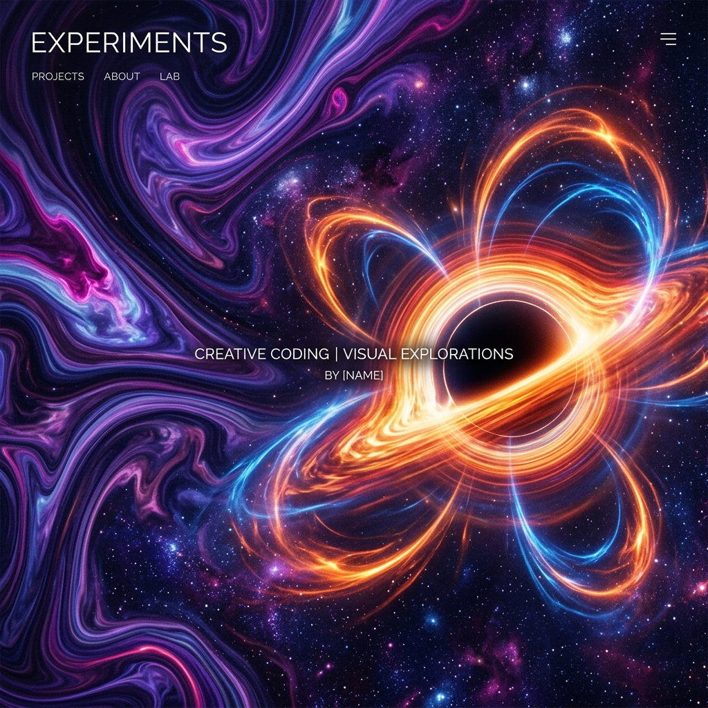

# Experiments — Vol. I
> A laboratory for creative physics, generative geometry, and computational aesthetics.

This repository serves as a research journal for exploring the intersection of mathematical rigor and visual art. Each experiment is a self-contained study in implementing complex physical phenomena or geometric systems within the browser.

---

## 🔬 Current Research (Volume I)

### [№ 01 — Flame Fractals](01_Flame/Flame3d_v003.html)
An implementation of Iterated Function Systems (IFS) based on Scott Draves' Fractal Flame algorithm.
- **Scope:** 2D and 3D density estimation rendering.
- **Key Features:** Nonlinear variations, logarithmic color mapping, and statistical super-sampling.

### [№ 02 — Gas Giant (S² FLIP)](02_Gas Giant/FLIPsphere_v001.html)
Fluid dynamics on a spherical manifold using a 6-face cubemap atlas.
- **Scope:** Planetary atmosphere visualization.
- **Key Features:** Geodesic advection, Jacobi pressure solve across cube seams (Helmholtz-Hodge decomposition), and no pole singularities.

### [№ 03 — Solar Corona (MHD)](03_Corona/Corona_v001.html)
A Magnetohydrodynamic (MHD) simulation of the Sun's atmosphere.
- **Scope:** Plasma dynamics and magnetic topology.
- **Key Features:** Magnetic loop force fields, procedural CME (Coronal Mass Ejection) events, and temperature-based color gradients.

### [№ 04 — Black Hole (Relativity)](04_Black Hole/Black Hole_v001.html)
An implementation of a ray-traced Schwarzschild black hole.
- **Scope:** General Relativity approximations in real-time.
- **Key Features:** Light bending (gravitational lensing), Doppler boosting, and accretion disk dynamics.
- **Bonus:** Included [WebGPU implementation](04_Black Hole/webgpu-black-hole/index.html) for high-performance compute-based ray-marching.

### [№ 11 — Erosion](11_Erosion/Erosion_v001_SDF.html)
True 3D volumetric erosion of layered desert rock on the GPU.
- **Scope:** Differential weathering of sedimentary strata (hoodoos, arches, mesas).
- **Key Features:** SDF raymarch render, connectivity-based floater culling, talus sedimentation.
- **Method:** 128³ density field on RGBA16Float textures, rain & wind dissolution with angle-of-repose sediment transport.

### [№ 12 — Audio Visualizer (STFT Spiral)](12_Audio Visualizer/AudioViz_v001.html)
Real-time 3D spectral spiral driven by Short-Time Fourier Transform.
- **Scope:** A geometrically faithful mapping of audio frequency spectra to 3D space.
- **Key Features:** x = f, y = |X|·cos(ϕ), z = |X|·sin(ϕ); live mic / file upload / synthetic demo.
- **Controls:** Three color modes, adjustable radius, auto-rotate camera, OrbitControls.

### [№ 13 — Arbor](13_Arbor/Arbor_v001.html)
Procedural tree generator with roots that grow around imported objects, exporting textured USD (.usda/.usdz).
- **Scope:** Space-colonization growth, obstacle SDF steering, strand-cylinder mesher, pure-JS USDZ.
- **Key Features:** Three species (oak/spruce/banyan), per-species vigor economy, thigmotropism (contact branching), root wrap around obstacles, procedural bark/root/twig textures, WebGL2 viewport, OBJ import.
- **Exports:** UsdPreviewSurface + UsdUVTexture materials, 64-byte-aligned USDZ archive, embeddable obstacles.

### [№ 14 — Orogeny (S² Stream Power)](14_Orogeny/Orogeny_v001.html)
Seamless planetary erosion — a whole planet held in erosional equilibrium.
- **Scope:** Uplift, fluvial incision, sediment transport and deposition on a closed sphere.
- **Key Features:** Equiangular cubed sphere with 1-texel ghost-cell halos, measured arc-length metric, Lagrangian droplets with a P2G/G2P grant cycle, talus, lithification, raymarched shell.
- **Method:** 6 × 512² RG32F height array; mean-zero (isostatic) uplift; mass audit closes to 0.02% over 10,000 steps.
- **Verification:** Built-in flat, isotropy and mass tests — cube corners perturb a diffusing feature by ≤0.12% of its amplitude.

---

## 🗺️ Roadmap

### Volume II: Quantum & Chaos (Q3 2026)
- **[№ 05 — Superfluid Vortices](05_Superfluid/briefing.md):** Ginzburg-Landau simulation of quantized vortices in Bose-Einstein condensates.
- **[№ 06 — N-Body Galactica](06_Galactica/briefing.md):** Barnes-Hut accelerated galaxy formation and dark matter dynamics.
- **[№ 07 — Wave Collapse](07_Wave Collapse/briefing.md):** 3D Schrödinger Equation visualization with quantum tunneling.
- **[№ 08 — Strange Attractors](08_Strange Attractors/briefing.md):** High-precision chaotic system integration (Aizawa/Thomas).

### Volume III: Morphogenesis (Q4 2026)
- **[№ 09 — Turing Manifolds](09_Turing Manifolds/briefing.md):** Reaction-Diffusion (Gray-Scott) implemented on arbitrary surface meshes.
- **[№ 10 — Crystal Growth](10_Crystal Growth/briefing.md):** 3D Diffusion Limited Aggregation (DLA) for mineral-like fractal growth.

---

## 🛠️ Technology Stack
- **Core:** Vanilla JavaScript (ES6+), HTML5 Canvas.
- **Graphics:** WebGL2 (Primary), WebGPU (Experimental).
- **Math:** GLSL Shaders for parallelized physical integration.
- **Design:** Cormorant Garamond & JetBrains Mono for the "Scientific Journal" aesthetic.

---

## 📜 License

### Source Code
The **source code** in this repository is licensed under the [MIT License](LICENSE).

### Generated Art & Media
Any images, animations, or parameter sets generated using the code in this repository are licensed under the [Creative Commons Attribution-NonCommercial 4.0 International (CC BY-NC 4.0)](https://creativecommons.org/licenses/by-nc/4.0/) license. 

---
*Created with passion for the physics of light and motion.*
